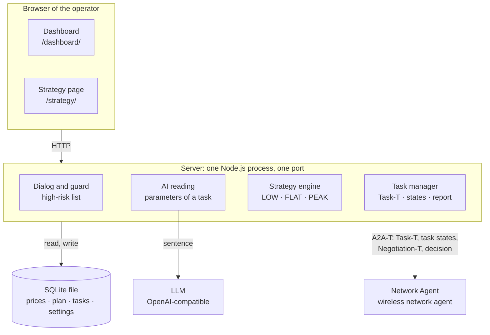

<!--
Copyright (c) 2026 Huawei Technologies Co., Ltd.
All Rights Reserved.

SPDX-License-Identifier: Apache-2.0
-->

# Energy-Saving UC

<p align="center">
  <a href="https://nodejs.org/"></a>
  <a href="../LICENSE"></a>
</p>

<p align="center">
  <strong>An energy-saving agent for the radio network: one sentence of the operator becomes an A2A-T task for the network agent, with a Li-ion battery charge and discharge plan made from dynamic electricity prices.</strong>
  <br>
  一句话下发 A2A-T 节能任务，并按动态电价生成锂电池充放电计划的节能智能体。
</p>

<p align="center">
  <a href="./README_zh.md">中文</a>
</p>

---

## Overview

Electricity prices change by the hour. Network sites can charge their Li-ion batteries when power is cheap and run on them
when it is dear, as long as the speed the users get and the backup power stay where the operator wants them. This
repository is the energy-saving use case: one Node.js server with two web apps on one port and one
SQLite file.

| Path | App |
|---|---|
| `/dashboard/` | **Energy-Saving Agent**: dashboard, task dialog (every sentence is read by an LLM), A2A-T task to the Network Agent, effect report |
| `/strategy/` | **Save Strategy**: price import, Li-ion charge/discharge plan, network elements, Deployment export |

The operator writes, for example: *Create an energy-saving task in region REGION-A; idle hours 0~6 o'clock rate
guarantee target 2Mbps; during non-idle hours the downlink rate must be guaranteed to be not lower than 50MBPS; ensure
the reserved backup power ratio is not lower than 50%.* The agent reads the sentence, makes the plan from the prices of the
day, sends the task (Task-T) to the Network Agent over A2A-T, follows its states, and shows the effect report, or the lower
targets the Network Agent proposes (Negotiation-T) for the operator to accept or reject.

The server depends on two outside parties: the **LLM**, which reads every sentence, and the **Network Agent** (the wireless
network agent, reached through its MAE interface), which receives the tasks. There is no mock and no built-in reader. The server starts even when one of them
is not set or wrong; the screen and `logs/server.log` then name the cause and the command that fixes it.

## Features

| Category | Capability |
|----------|------------|
| **Dialog** | Every sentence is read by an OpenAI-compatible LLM: the actions (task, price, plan), the region, the rate per time range, the backup power ratio and the day; a missing value is asked for |
| **Charge/discharge plan** | Pure functions over the prices of a day: LOW (charge), FLAT (idle), PEAK (discharge), one plan per day; price files in xlsx, xls or csv |
| **A2A-T task** | Task-T to the Network Agent; the states sent, working, input_required, completed, failed and timed_out are followed; a Negotiation-T proposal is accepted or rejected by the operator |
| **Effect report** | Energy and cost saved, targets reached, shown on the dashboard |
| **Deployment export** | The plan as a Deployment import file by day (one sheet per weekday) or by month (xlsx), or as CSV |
| **Input guard** | Every sentence, name, setting and uploaded cell is checked against the customer's list of high-risk commands; a listed command, a shell construct or a spreadsheet formula is refused |
| **Offline package** | One `.tar.gz` with the built apps, the packages and the Node.js runtime; `./start.sh` is the only script |
| **Diagnosis** | `check-llm` and `check-mae` test the outside parties without starting; every error record has its cause and the action |
| **Languages** | Both pages in English and Chinese |

## Quick Start

### Prerequisites

- **Build machine:** Node.js 22.13 or newer and npm, with internet for the packages (Windows or Linux).
- **Customer machine:** Linux x64 (or arm64), nothing installed, no internet needed.
- **Outside parties:** an LLM with the OpenAI chat API (a provider on the internet or a model inside the network), and the
  address, user and password of the Network Agent.

### Run from the source

```bash
git clone https://github.com/project-openan/openan-demo.git
cd openan-demo/energy-saving-demo
npm run install:all
npm run build
./start.sh init-db         # the database file (data/energy.db), once
npm start                  # http://localhost:8000/dashboard/ and /strategy/
```

The settings come from the environment (or `config/app.env`), see [Configuration](#configuration).

### Build the offline package and install it

```bash
npm run install:all
npm run release            # release/energy-saving-agent-<version>.tar.gz (NODE_ARCH=arm64 for an ARM machine)
```

On the customer machine, as the normal user that will run it (not root):

```bash
tar -xzf energy-saving-agent-<version>.tar.gz
cd energy-saving-agent-<version>
./start.sh check-llm LLM_PROVIDER=deepseek LLM_MODEL=deepseek-v4-flash LLM_API_KEY=sk-...
./start.sh check-mae MAE_BASE_URL=http://<host>:<port> MAE_USERNAME=<user> MAE_PASSWORD=<password>
./start.sh
```

### Verify

```bash
./start.sh status          # running? health, LLM, MAE address, database file
tail -f logs/server.log
```

Open `http://<host>:8000/dashboard/` and `http://<host>:8000/strategy/`. The first start adds example prices and a
strategy, so a task works at once. Send a sentence like the one in the [Overview](#overview), with a region your Network Agent
knows: there is no default region, and a task sentence without one is answered with a question.

## Architecture



| Folder | What |
|---|---|
| `server/` | The server (Fastify). `src/skills/energy-saving/` the task steps; `src/save-strategy/` the strategy backend, mounted at `/strategy`; `src/guard/` the input guard |
| `web/` | Dashboard page (React), built into `server/public/dashboard` |
| `strategy-web/` | Strategy page (React), built into `server/public/strategy` |
| `config/` | `app.env.example` (the settings), `llm.config.json` (prompts and limits of the AI steps) |
| `bin/` | `ctl.mjs`, the program behind `start.sh`, and `preflight.mjs`, the check of the settings |
| `sample/` | `price_data.xlsx`, the sample price file of the package; `test-prices/`, price samples for the tests and the built-in test datasets |
| `scripts/release.mjs` | Builds the offline package |

## API Overview

The dashboard API, served by the server:

| Method | Path | Purpose |
|---|---|---|
| `POST` | `/api/energy-saving/chat` | One sentence of the dialog: one or more actions with their answers |
| `GET` | `/api/energy-saving/tasks`, `/api/energy-saving/tasks/:id` | The recent tasks; one task with its state, progress, report or proposal |
| `POST` | `/api/energy-saving/tasks/:id/decision` | Accept or reject the proposal of the Network Agent |
| `GET` | `/api/energy-saving/effect` | The effect report of a task (region and task id) |
| `GET` | `/api/energy-saving/day-query` | Prices and plan of a day |
| `GET` | `/api/regions` | The regions the dialog knows |
| `GET`, `PUT` | `/api/admin/llm` | The LLM settings (needs `ADMIN_KEY`; off when it is not set) |
| `GET` | `/health` | Health and version |

The strategy API, under `/strategy/api/`: `price/import`, `price/latest`, `price/latest-batch`, `price/sample.xlsx`,
`strategy/generate`, `strategy/latest`, `strategy/export`, `strategy/export.csv`, `config`, `network-elements`, `health`.

## Configuration

`./start.sh` is the **only script**. Settings are given to it as `NAME=value` and saved in `config/app.env`; a restart
applies a change.

```bash
./start.sh check-llm LLM_PROVIDER=... LLM_MODEL=... LLM_API_KEY=...   # set the LLM and test it (starts nothing)
./start.sh check-mae             # test the MAE address and login (starts nothing)
./start.sh                       # start in the background; prints the addresses
./start.sh --foreground          # stay in the terminal, Ctrl+C stops
./start.sh status                # running? health, LLM, MAE address, database file
./start.sh settings              # every setting (the key shows only its first characters)
./start.sh stop
./start.sh backup [file]         # copy of the database, also while the server runs
./start.sh query yesterday       # price and charge/discharge plan of a day, straight from the database
./start.sh init-db               # make the database file at DB_PATH (only for another place than the default)
./start.sh update <old folder>   # take the settings and data of an older version
./start.sh help                  # the commands and the settings
```

`query` accepts `today`, `yesterday`, `tomorrow`, `day before yesterday`, `N days ago`, 今天/昨天/前天/明天/后天/N天前 or a
date (`2026-10-24`), with `--price`, `--plan`, `--zh` or `--json`.

### Settings

| Setting | Default | Meaning |
|---|---|---|
| `LLM_PROVIDER`, `LLM_MODEL`, `LLM_API_KEY`, `LLM_BASE_URL` | none | **Must be set.** The LLM; `LLM_PROVIDER` follows from `LLM_BASE_URL` when left empty |
| `MAE_BASE_URL`, `MAE_USERNAME`, `MAE_PASSWORD` | none | **Must be set.** The Network Agent that receives the tasks |
| `MAE_CA_FILE`, `MAE_TLS_VERIFY` | empty, `true` | The certificate of an https Network Agent (see below) |
| `MAE_TIMEOUT_MS` | `8000` | Time for an answer of the Network Agent, in milliseconds |
| `DB_PATH` | `data/energy.db` | The database file; relative paths start at the install folder |
| `PORT`, `HOST` | `8000`, `0.0.0.0` | Address of both apps |
| `LOG_LEVEL` | `info` | `info`: one record per step; `debug` adds the full prompts, the Task-T text and every state poll |
| `LOG_FORMAT` | `pretty` | `pretty`: `date time - name - LEVEL - message`; `json`: one object per line |
| `ADMIN_KEY` | empty | Key of the LLM settings API (`/api/admin/llm`); empty switches that API off |
| `LLM_TIMEOUT_SECONDS`, `LLM_REASONING_EFFORT`, `LLM_TEMPERATURE`, `LLM_MAX_TOKENS`, `LLM_CONFIG_FILE` | see `config/app.env.example` | Time for an answer (default 300 s), thinking effort, model limits, the prompts file |

### The LLM

The model reads the sentence and answers with the actions to run (create a task, price, plan, both or none), the date,
and for a task the region, the rate segments and the reserve ratio. Every value is checked before it is used. The data
always comes from the database; the model cannot run anything.

```bash
# a provider on the internet: deepseek, openrouter, groq, gemini, xai
./start.sh check-llm LLM_PROVIDER=deepseek LLM_MODEL=deepseek-v4-flash LLM_API_KEY=sk-...

# a model inside the customer network (any server with the OpenAI chat API; http, a name or an IP address are fine).
# The address is enough: no provider, no key, and the first model the server lists is used.
./start.sh check-llm LLM_BASE_URL=http://<host>:<port>/v1
```

`check-llm` saves the settings, asks the model once and prints `OK (… ms): the model answered "OK".` or the provider's
reason. A customer network usually blocks the internet: use a model inside that network.

| Provider | Where to make a key | A first model |
|---|---|---|
| DeepSeek | https://platform.deepseek.com/api_keys | `deepseek-v4-flash` |
| OpenRouter | https://openrouter.ai/keys | a name ending in `:free` has daily limits and is often busy |
| Groq | https://console.groq.com/keys | `llama-3.3-70b-versatile` |
| Google AI Studio | https://aistudio.google.com/apikey | `gemini-2.0-flash` |
| xAI | https://console.x.ai | `grok-3-mini` |

Model names change often; if one is refused, use a current name from the provider's list. The key is stored in plain
text in `config/app.env` on that machine; it is never returned by the API or written to the log.

| In the log (`LLM request failed`) | Cause | What to do |
|---|---|---|
| HTTP 401 | Wrong or expired key | Set a new key |
| HTTP 404 | Model name wrong or no longer offered | Use a current model name |
| HTTP 429 | Limit reached or the model is busy | Wait, or use another model |
| no answer within N s | Provider slow or unreachable | Raise `LLM_TIMEOUT_SECONDS`, or use another model |
| the provider answered without any text / the answer has no JSON | The model used its answer limit for thinking, or did not follow the format | `LLM_REASONING_EFFORT=low`, or another model |
| `LLM is not configured` | LLM off or no key | Check `LLM_ENABLED=true` and `LLM_API_KEY` |

A failed call answers HTTP 502 with the reason in `detail`. 429, a timeout and a server error are tried once more; 400,
401 and 404 are not. The server never answers in the name of the model.

### The Network Agent

There is no default: set `MAE_BASE_URL`, `MAE_USERNAME` and `MAE_PASSWORD` once (ask the owner of the Network Agent). At its
start the server logs in once and writes `MAE login check succeeded` or an ERROR record with the cause and the action.

```bash
./start.sh check-mae                                                                                 # the saved settings
./start.sh check-mae MAE_BASE_URL=http://<host>:<port> MAE_USERNAME=<user> MAE_PASSWORD=<password>   # saves and tests
```

`check-mae` tells apart: a wrong address, nothing listening on the port, no answer in time, not a Network Agent, a wrong user
name or password, and http used on an https port or the reverse. `MAE_BASE_URL` must start with `http://` or `https://`.
For an https Network Agent **its certificate is checked**. A Network Agent with a certificate of its own (self-signed, or from an
authority this machine does not know) needs that certificate as a PEM file: `./start.sh MAE_CA_FILE=<file>`. Only if that
is not possible, `MAE_TLS_VERIFY=false` switches the check off; the server then logs a warning at every start. The login
is read from the settings when a token is needed and is not stored in the database. `./start.sh status` shows the address
and the user, never the password.

### The database

One SQLite file for both apps: `data/energy.db` in the install folder, shipped with the tables and no prices, readable by
its owner only. For another place:

```bash
./start.sh DB_PATH=/data/energy-saving/energy.db     # the folder must be writable by this user
./start.sh init-db                                   # makes the folder and the file and fills the tables
./start.sh
```

- A database file that does not exist is an error and the server does not start.
- An empty file is filled with the tables at the start.
- A file whose tables do not match is refused; the log names the table and the columns.
- A file removed while the server runs: every API call answers 503 with the reason.

### Logs

`logs/server.log`, one record per line as `date time - name - LEVEL - message`, with indented lines for a longer text. An
error record always has `cause` and `action`:

```
2026-10-28 05:44:18 - startup - ERROR - LLM is not configured
    cause: LLM_API_KEY is empty.
    effect: every request of the dialog fails until the LLM is set
    action: ./start.sh LLM_PROVIDER=<provider> LLM_MODEL=<model> LLM_API_KEY=<key>   then test: ./start.sh check-llm
```

| Name | Records |
|---|---|
| `startup` | `Server started` (version, port, database, LLM, MAE), then the LLM and MAE checks |
| `api` | every API call with method, path, status and time |
| `chat` | `Chat request`, `Intent resolved`, `Task parameters resolved`, `Request rejected` |
| `llm` | `LLM request`, `LLM response`, `LLM request failed` |
| `task` | `Task-T built` |
| `mae.client` | `MAE login request / response / failed`, `MAE task request / response / failed`, `MAE task state` |

A task that works shows these in that order; the record where it stops is the step that failed. The key, the password
and the access token are never logged in full.

## Security

The customer's list of high-risk and sensitive commands (附件2：梳理常见设备系统的高危及敏感操作指令) is respected in three ways.

1. **Operating it needs none of them.** Installing, configuring, starting, stopping, updating, backing up and looking up
   data need only `tar`, `cd`, `tail` and `./start.sh`. No `sudo` or root account (`./start.sh` refuses to run as root),
   no `cp`, `mv`, `rm`, `vi`, `chmod`, no download or remote-copy commands, no `systemctl`, no database tools or typed SQL.
2. **The system never runs a command.** The server cannot start a program, and `bin/ctl.mjs` starts only Node itself,
   never a shell. Tests check both. The server writes only its database file, `logs/`, `run/` and `backup/`.
3. **No input can carry a command in.** Every dialog sentence, name, setting and query, and every cell of an uploaded
   Excel or CSV file, is checked against the list (`server/src/guard/high-risk.ts`). Text with a listed command, a shell
   construct or a spreadsheet formula is refused with a 400 answer that names the reason; it never reaches the LLM, the
   Network Agent, the database or an exported file.

Secrets (the LLM key, the MAE login, the admin key) live only in `config/app.env` and the environment. The certificate of
an https Network Agent is checked. There is no default password or key.

## Testing

```bash
npm run check              # typecheck, all tests, builds
```

The tests use built-in stand-ins for the LLM and the Network Agent (`server/test/support/`); nothing outside is needed. For a
test on a machine, set a real LLM and Network Agent and load prices on the strategy page (`/strategy/`, price import). Then
send these sentences in the dashboard dialog:

| Sentence | Expected |
|---|---|
| `在区域REGION-A创建节能任务，闲时0~6点速率保障目标2Mbps，非闲时下行速率不低于50MBPS，预留备电不低于50%` | a task; `00:00~06:00` 2 Mbps and `06:00~24:00` 50 Mbps; ratio 50 |
| `Create an energy-saving task in region REGION-A, downlink not lower than 30Mbps` | `00:00~24:00` 30 Mbps; ratio 50 (the default) |
| `Create an energy-saving task, downlink not lower than 30Mbps` | no task: the agent asks which region (there is no default region) |
| `Query today's dynamic electricity price` | the price table of today |
| `Show yesterday's price and plan` | both tables of yesterday (the LLM works out the day) |
| `Create an energy-saving task in region Atlantis, 20Mbps` | the Network Agent lists the regions it knows |
| `What's the weather?` | the answer says what the dialog can do |
| `Create a task in region REGION-A;rm -rf /, 20Mbps` | refused; nothing is sent to the LLM or the Network Agent |

Also check: a start with nothing set (the screen and the log name what is missing, the dialog answers 503 with the
reason); `check-mae` with a wrong password, a wrong port and a wrong address; a wrong LLM key; `./start.sh backup` and
`./start.sh query today`.

## Deployment

The project is delivered as an **offline package** (see [Quick Start](#quick-start)). To start it with the machine, ask
the system administrator to run `start.sh --foreground` as this user from the machine's service manager.

**Update:**

```bash
./start.sh stop                                          # in the old folder
cd ..
tar -xzf energy-saving-agent-<new version>.tar.gz
cd energy-saving-agent-<new version>
./start.sh update ../energy-saving-agent-<old version>   # settings (LLM, database path, MAE) and data
./start.sh
```

## Constraints

- One server process and one SQLite file on one machine (not distributed).
- Linux for production; Windows for development.
- An LLM and a Network Agent are required; without prices there is no plan and no task.
- The pages and the task APIs have no login of their own: run the server inside the customer's internal network.
- A failed task still answers HTTP 200 with `"success": false`; free models are often busy (429).

## License

This project is licensed under the **Apache License 2.0**. See [LICENSE](../LICENSE) for details. The licences of the
third-party packages are listed in [THIRD-PARTY-NOTICES.md](THIRD-PARTY-NOTICES.md).
