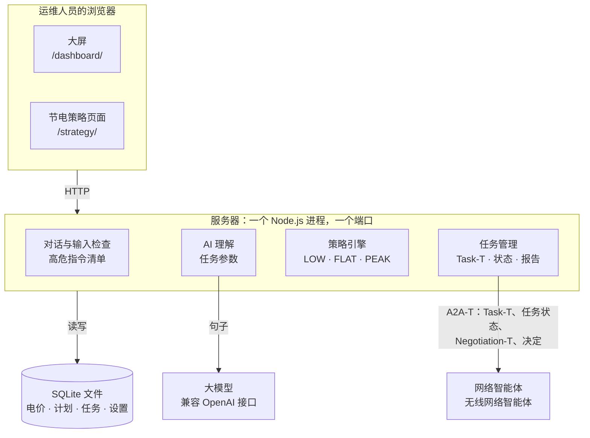

<!--
Copyright (c) 2026 Huawei Technologies Co., Ltd.
All Rights Reserved.

SPDX-License-Identifier: Apache-2.0
-->

# 节能 UC

<p align="center">
  <a href="https://nodejs.org/"></a>
  <a href="../LICENSE"></a>
</p>

<p align="center">
  <strong>无线网络节能智能体：运维人员的一句话变成发给网络智能体的 A2A-T 任务，并按动态电价生成锂电池充放电计划。</strong>
  <br>
  An energy-saving agent for the radio network: one sentence becomes an A2A-T task, with a Li-ion charge and discharge plan from dynamic electricity prices.
</p>

<p align="center">
  <a href="./README.md">English</a>
</p>

---

## 概述

电价按小时变化。只要用户得到的速率和备电保持在运维人员要求的水平，站点就可以在电价低时给锂电池充电，在电价高时由电池供电。
本仓库是节能用例：一个 Node.js 服务器，在同一端口上提供两个 Web 应用，共用一个 SQLite 文件。

| 路径 | 应用 |
|---|---|
| `/dashboard/` | **节能智能体**：大屏、任务对话框（每句话都由大模型理解）、向 网络智能体下发 A2A-T 任务、效果报告 |
| `/strategy/` | **节电策略**：电价导入、锂电充放电计划、网元、Deployment 导出 |

运维人员输入，例如：*在区域REGION-A创建节能任务，闲时0~6点速率保障目标2Mbps，非闲时下行速率不低于50MBPS，预留备电不低于50%。*
智能体理解这句话，按当天的电价生成计划，通过 A2A-T 把任务（Task-T）发给 网络智能体，跟踪任务状态，并显示效果报告；如果 MAE
智能体提出更低的目标（Negotiation-T），由运维人员接受或拒绝。

服务器依赖两个外部方：**大模型**读取每一句话，**网络智能体**（无线网络智能体，通过其 MAE 接口访问）接收任务。没有任何模拟或内置的理解器。即使其中一个
未设置或设置错误，服务器也会启动；屏幕和 `logs/server.log` 会说明原因和修复命令。

## 功能

| 类别 | 能力 |
|----------|------------|
| **对话** | 每句话都由兼容 OpenAI 接口的大模型理解：要执行的功能（任务、电价、计划）、区域、各时段速率、备电比例和日期；缺少的值会追问 |
| **充放电计划** | 基于当天电价的纯函数：LOW（充电）、FLAT（空闲）、PEAK（放电），每天一个计划；电价文件支持 xlsx、xls 或 csv |
| **A2A-T 任务** | 向 网络智能体发送 Task-T；跟踪 sent、working、input_required、completed、failed 和 timed_out 状态；Negotiation-T 提议由运维人员接受或拒绝 |
| **效果报告** | 节省的电量和电费、目标达成情况，显示在大屏上 |
| **Deployment 导出** | 按天（每个星期几一页）或按月的 Deployment 导入文件（xlsx），或 CSV |
| **输入检查** | 每句话、每个名称、设置和上传的单元格都按客户的高危指令清单检查；含清单中指令、shell 结构或电子表格公式的输入会被拒绝 |
| **离线安装包** | 一个 `.tar.gz`，包含已构建的应用、依赖和 Node.js 运行时；`./start.sh` 是唯一的脚本 |
| **诊断** | `check-llm` 和 `check-mae` 不启动服务即可测试外部方；每条错误记录都带有原因和处理办法 |
| **语言** | 两个页面都有中文和英文 |

## 快速开始

### 前提条件

- **构建机器：** Node.js 22.13 或更新版本和 npm，可以上网下载依赖（Windows 或 Linux）。
- **客户机器：** Linux x64（或 arm64），不需要预先安装任何东西，不需要互联网。
- **外部方：** 兼容 OpenAI 对话接口的大模型（互联网上的服务商或网络内部的模型），以及 网络智能体的地址、用户名和密码。

### 从源码运行

```bash
git clone https://github.com/project-openan/openan-demo.git
cd openan-demo/energy-saving-demo
npm run install:all
npm run build
./start.sh init-db         # 数据库文件（data/energy.db），只需一次
npm start                  # http://localhost:8000/dashboard/ 和 /strategy/
```

设置来自环境变量（或 `config/app.env`），见[配置](#配置)。

### 构建离线安装包并安装

```bash
npm run install:all
npm run release            # release/energy-saving-agent-<版本>.tar.gz（ARM 机器用 NODE_ARCH=arm64）
```

在客户机器上，以运行它的普通用户身份（不要用 root）：

```bash
tar -xzf energy-saving-agent-<版本>.tar.gz
cd energy-saving-agent-<版本>
./start.sh check-llm LLM_PROVIDER=deepseek LLM_MODEL=deepseek-v4-flash LLM_API_KEY=sk-...
./start.sh check-mae MAE_BASE_URL=http://<主机>:<端口> MAE_USERNAME=<用户> MAE_PASSWORD=<密码>
./start.sh
```

### 验证

```bash
./start.sh status          # 是否运行、健康状态、大模型、MAE 地址、数据库文件
tail -f logs/server.log
```

打开 `http://<主机>:8000/dashboard/` 和 `http://<主机>:8000/strategy/`。首次启动会写入示例电价和策略，
因此可以立即下发任务。发送一句类似[概述](#概述)中的话，写上 网络智能体知道的区域：没有默认区域，没有写区域的任务句子会得到一个提问。

## 架构



| 文件夹 | 内容 |
|---|---|
| `server/` | 服务器（Fastify）。`src/skills/energy-saving/` 是任务的各个步骤；`src/save-strategy/` 是节电策略的后端，挂载在 `/strategy`；`src/guard/` 是输入检查 |
| `web/` | 大屏页面（React），构建到 `server/public/dashboard` |
| `strategy-web/` | 节电策略页面（React），构建到 `server/public/strategy` |
| `config/` | `app.env.example`（设置）、`llm.config.json`（AI 步骤的提示词和取值范围） |
| `bin/` | `ctl.mjs` 是 `start.sh` 背后的程序，`preflight.mjs` 检查设置 |
| `sample/` | `price_data.xlsx` 是安装包中的示例电价文件；`test-prices/` 是测试和内置测试数据集使用的电价样本 |
| `scripts/release.mjs` | 构建离线安装包 |

## 接口概览

大屏接口，由服务器提供：

| 方法 | 路径 | 用途 |
|---|---|---|
| `POST` | `/api/energy-saving/chat` | 对话中的一句话：一个或多个功能及其回答 |
| `GET` | `/api/energy-saving/tasks`、`/api/energy-saving/tasks/:id` | 最近的任务；单个任务的状态、进度、报告或提议 |
| `POST` | `/api/energy-saving/tasks/:id/decision` | 接受或拒绝 网络智能体的提议 |
| `GET` | `/api/energy-saving/effect` | 任务的效果报告（区域和任务 ID） |
| `GET` | `/api/energy-saving/day-query` | 某一天的电价和计划 |
| `GET` | `/api/regions` | 对话框知道的区域 |
| `GET`、`PUT` | `/api/admin/llm` | 大模型设置（需要 `ADMIN_KEY`；未设置时关闭） |
| `GET` | `/health` | 健康状态和版本 |

节电策略接口，位于 `/strategy/api/` 下：`price/import`、`price/latest`、`price/latest-batch`、`price/sample.xlsx`、
`strategy/generate`、`strategy/latest`、`strategy/export`、`strategy/export.csv`、`config`、`network-elements`、`health`。

## 配置

`./start.sh` 是**唯一的脚本**。设置以 `NAME=值` 的形式交给它，并保存在 `config/app.env` 中；重启后生效。

```bash
./start.sh check-llm LLM_PROVIDER=... LLM_MODEL=... LLM_API_KEY=...   # 设置大模型并测试（不启动）
./start.sh check-mae             # 测试 MAE 地址和登录（不启动）
./start.sh                       # 后台启动，并显示访问地址
./start.sh --foreground          # 留在终端中运行，Ctrl+C 停止
./start.sh status                # 是否运行、健康状态、大模型、MAE 地址、数据库文件
./start.sh settings              # 全部设置（密钥只显示前几个字符）
./start.sh stop
./start.sh backup [文件]          # 备份数据库，服务器运行时也可以
./start.sh query yesterday       # 某一天的电价和充放电计划，直接读取数据库
./start.sh init-db               # 在 DB_PATH 处创建数据库文件（仅在不使用默认位置时需要）
./start.sh update <旧文件夹>      # 带过来旧版本的设置和数据
./start.sh help                  # 命令和设置
```

`query` 接受 `today`、`yesterday`、`tomorrow`、`day before yesterday`、`N days ago`、今天/昨天/前天/明天/后天/N天前，或具体日期
（`2026-10-24`），并可加 `--price`、`--plan`、`--zh` 或 `--json`。

### 设置

| 设置 | 默认值 | 含义 |
|---|---|---|
| `LLM_PROVIDER`、`LLM_MODEL`、`LLM_API_KEY`、`LLM_BASE_URL` | 无 | **必须设置。** 大模型；`LLM_PROVIDER` 为空时由 `LLM_BASE_URL` 推断 |
| `MAE_BASE_URL`、`MAE_USERNAME`、`MAE_PASSWORD` | 无 | **必须设置。** 接收任务的 网络智能体 |
| `MAE_CA_FILE`、`MAE_TLS_VERIFY` | 空、`true` | 使用 https 的 网络智能体的证书（见下文） |
| `MAE_TIMEOUT_MS` | `8000` | 等待 网络智能体应答的毫秒数 |
| `DB_PATH` | `data/energy.db` | 数据库文件；相对路径从安装文件夹算起 |
| `PORT`、`HOST` | `8000`、`0.0.0.0` | 两个应用的地址 |
| `LOG_LEVEL` | `info` | `info`：每一步一条记录；`debug` 增加完整提示词、Task-T 文本和每次状态查询 |
| `LOG_FORMAT` | `pretty` | `pretty`：`日期 时间 - 名称 - 级别 - 消息`；`json`：每行一个对象 |
| `ADMIN_KEY` | 空 | 大模型设置接口（`/api/admin/llm`）的密钥；为空表示关闭该接口 |
| `LLM_TIMEOUT_SECONDS`、`LLM_REASONING_EFFORT`、`LLM_TEMPERATURE`、`LLM_MAX_TOKENS`、`LLM_CONFIG_FILE` | 见 `config/app.env.example` | 等待应答的时间（默认 300 秒）、思考强度、模型限制、提示词文件 |

### 大模型

大模型读取对话句子，回答要执行的功能（创建任务、电价、计划、两者或无）、日期，以及任务的区域、速率分段和备电比例。每个值在使用前
都会检查。数据始终来自数据库；大模型无法执行任何操作。

```bash
# 互联网上的服务商：deepseek、openrouter、groq、gemini、xai
./start.sh check-llm LLM_PROVIDER=deepseek LLM_MODEL=deepseek-v4-flash LLM_API_KEY=sk-...

# 客户网络内部的模型（任何兼容 OpenAI 对话接口的服务；http、域名或 IP 地址都可以）。
# 只需地址：无需服务商、无需密钥，并使用服务器列出的第一个模型。
./start.sh check-llm LLM_BASE_URL=http://<主机>:<端口>/v1
```

`check-llm` 保存设置，向大模型询问一次，显示 `OK (… ms): the model answered "OK".` 或服务商给出的原因。客户网络通常无法访问
互联网：请使用该网络内的模型。

| 服务商 | 创建密钥的地址 | 入门模型 |
|---|---|---|
| DeepSeek | https://platform.deepseek.com/api_keys | `deepseek-v4-flash` |
| OpenRouter | https://openrouter.ai/keys | 名称以 `:free` 结尾的模型有每日限额，且经常繁忙 |
| Groq | https://console.groq.com/keys | `llama-3.3-70b-versatile` |
| Google AI Studio | https://aistudio.google.com/apikey | `gemini-2.0-flash` |
| xAI | https://console.x.ai | `grok-3-mini` |

模型名称经常变化；名称被拒绝时，请使用服务商列表中的当前名称。密钥以明文保存在该机器的 `config/app.env` 中，接口不会返回它，
日志也不会记录它。

| 日志中（`LLM request failed`） | 原因 | 处理办法 |
|---|---|---|
| HTTP 401 | 密钥错误或已过期 | 设置新的密钥 |
| HTTP 404 | 模型名称错误或已下线 | 使用当前的模型名称 |
| HTTP 429 | 达到限额或模型繁忙 | 稍后再试，或换一个模型 |
| no answer within N s | 服务商缓慢或无法访问 | 增大 `LLM_TIMEOUT_SECONDS`，或换一个模型 |
| the provider answered without any text / the answer has no JSON | 大模型把答案上限用在了思考上，或没有按格式回答 | `LLM_REASONING_EFFORT=low`，或换一个模型 |
| `LLM is not configured` | 大模型未开启或没有密钥 | 检查 `LLM_ENABLED=true` 和 `LLM_API_KEY` |

调用失败时返回 HTTP 502，原因在 `detail` 中。429、超时和服务器错误会重试一次；400、401 和 404 不重试。服务器从不代替大模型回答。

### 网络智能体

没有默认值：请设置一次 `MAE_BASE_URL`、`MAE_USERNAME` 和 `MAE_PASSWORD`（向 网络智能体的负责人索取）。服务器启动时登录一次，
并写入 `MAE login check succeeded` 或带原因和处理办法的 ERROR 记录。

```bash
./start.sh check-mae                                                                         # 已保存的设置
./start.sh check-mae MAE_BASE_URL=http://<主机>:<端口> MAE_USERNAME=<用户> MAE_PASSWORD=<密码>   # 保存并测试
```

`check-mae` 能区分：地址错误、端口无监听、未在时限内应答、不是 网络智能体、用户名或密码错误，以及在 https 端口上使用了 http
或相反。`MAE_BASE_URL` 必须以 `http://` 或 `https://` 开头。对于使用 https 的 网络智能体，**会检查其证书**。使用自有证书
（自签名，或来自本机不认识的机构）的 网络智能体，需要把该证书作为 PEM 文件提供：`./start.sh MAE_CA_FILE=<文件>`。仅在无法提供时，
才用 `MAE_TLS_VERIFY=false` 关闭检查，此时服务器每次启动都会记录警告。登录信息在需要令牌时从设置中读取，不保存在数据库中。
`./start.sh status` 显示地址和用户，从不显示密码。

### 数据库

两个应用共用一个 SQLite 文件：安装文件夹中的 `data/energy.db`，安装包自带表结构，不含电价，只有其所有者可以读取。放在其他位置时：

```bash
./start.sh DB_PATH=/data/energy-saving/energy.db     # 该文件夹必须可由此用户写入
./start.sh init-db                                   # 创建文件夹和文件，并建好各表
./start.sh
```

- 数据库文件不存在是错误，服务器不会启动。
- 空文件会在启动时建好各表。
- 表结构不符的文件会被拒绝；日志会指出表和列。
- 服务器运行时文件被删除：每个接口调用都返回 503 并说明原因。

### 日志

`logs/server.log`，每条记录一行：`日期 时间 - 名称 - 级别 - 消息`，较长的文字用缩进行。错误记录总是带有 `cause` 和 `action`：

```
2026-10-28 05:44:18 - startup - ERROR - LLM is not configured
    cause: LLM_API_KEY is empty.
    effect: every request of the dialog fails until the LLM is set
    action: ./start.sh LLM_PROVIDER=<provider> LLM_MODEL=<model> LLM_API_KEY=<key>   then test: ./start.sh check-llm
```

| 名称 | 记录 |
|---|---|
| `startup` | `Server started`（版本、端口、数据库、大模型、MAE），然后是大模型和 MAE 的检查 |
| `api` | 每个接口调用的方法、路径、状态和耗时 |
| `chat` | `Chat request`、`Intent resolved`、`Task parameters resolved`、`Request rejected` |
| `llm` | `LLM request`、`LLM response`、`LLM request failed` |
| `task` | `Task-T built` |
| `mae.client` | `MAE login request / response / failed`、`MAE task request / response / failed`、`MAE task state` |

正常的任务按上述顺序出现这些记录；停在哪条记录，就是哪一步失败。密钥、密码和访问令牌从不完整写入日志。

## 安全

本系统从三个方面遵守客户的高危及敏感操作指令清单（附件2：梳理常见设备系统的高危及敏感操作指令）。

1. **运维操作不需要清单中的任何指令。** 安装、配置、启动、停止、升级、备份和查询数据只需要 `tar`、`cd`、`tail` 和 `./start.sh`。
   不需要 `sudo` 或 root 账号（`./start.sh` 拒绝以 root 运行），不需要 `cp`、`mv`、`rm`、`vi`、`chmod`，不需要下载或远程复制指令，
   不需要 `systemctl`，也不需要数据库工具或手工输入的 SQL。
2. **系统本身从不执行指令。** 服务器无法启动任何程序，`bin/ctl.mjs` 只会启动 Node 本身，从不启动 shell；测试会检查这两点。
   服务器只写入自己的数据库文件、`logs/`、`run/` 和 `backup/`。
3. **任何输入都无法夹带指令。** 每一句对话、每个名称、设置和查询参数，以及上传的 Excel 或 CSV 文件中的每个单元格，都会按清单检查
   （`server/src/guard/high-risk.ts`）。含有清单中指令、shell 结构或电子表格公式的文字会被拒绝，返回 400 并说明原因；它不会到达
   大模型、网络智能体、数据库或导出文件。

密钥类信息（大模型密钥、MAE 登录信息、管理密钥）只存在于 `config/app.env` 和环境变量中。使用 https 的 网络智能体的证书会被检查。
没有默认密码或默认密钥。

## 测试

```bash
npm run check              # 类型检查、全部测试、构建
```

测试使用内置的大模型和 网络智能体替身（`server/test/support/`），不需要任何外部系统。在机器上测试时，请设置真实的大模型和
网络智能体，并在节电策略页面（`/strategy/`，电价导入）载入电价。然后在大屏对话框中发送这些句子：

| 句子 | 预期 |
|---|---|
| `在区域REGION-A创建节能任务，闲时0~6点速率保障目标2Mbps，非闲时下行速率不低于50MBPS，预留备电不低于50%` | 一个任务；`00:00~06:00` 2 Mbps 和 `06:00~24:00` 50 Mbps；比例 50 |
| `Create an energy-saving task in region REGION-A, downlink not lower than 30Mbps` | `00:00~24:00` 30 Mbps；比例 50（默认值） |
| `Create an energy-saving task, downlink not lower than 30Mbps` | 不下发任务：智能体询问区域（没有默认区域） |
| `查询今天的动态电价` | 今天的电价表 |
| `查看昨天的电价和计划` | 昨天的两张表（日期由大模型推算） |
| `Create an energy-saving task in region Atlantis, 20Mbps` | 网络智能体列出它知道的区域 |
| `今天天气怎么样？` | 回答说明对话框能做什么 |
| `Create a task in region REGION-A;rm -rf /, 20Mbps` | 被拒绝；不会发送给大模型或 网络智能体 |

还要检查：什么都不设置时启动（屏幕和日志说明缺少什么，对话框返回 503 和原因）；用错误的密码、端口和地址运行 `check-mae`；
错误的大模型密钥；`./start.sh backup` 和 `./start.sh query today`。

## 部署

本项目以**离线安装包**交付（见[快速开始](#快速开始)）。如需开机自启，请联系系统管理员，在系统的服务管理中以该用户身份运行
`start.sh --foreground`。

**升级：**

```bash
./start.sh stop                                     # 在旧版本文件夹中
cd ..
tar -xzf energy-saving-agent-<新版本>.tar.gz
cd energy-saving-agent-<新版本>
./start.sh update ../energy-saving-agent-<旧版本>   # 设置（大模型、数据库路径、MAE）和数据
./start.sh
```

## 约束

- 一台机器上一个服务器进程和一个 SQLite 文件（非分布式）。
- 生产环境为 Linux；开发环境为 Windows。
- 必须有大模型和 网络智能体；没有电价就没有计划，也无法下发任务。
- 页面和任务接口本身没有登录：请在客户的内部网络中运行服务器。
- 失败的任务仍返回 HTTP 200 和 `"success": false`；免费模型经常繁忙（429）。

## 许可证

本项目采用 **Apache License 2.0** 许可证，详见 [LICENSE](../LICENSE)。第三方依赖的许可证列在
[THIRD-PARTY-NOTICES.md](THIRD-PARTY-NOTICES.md) 中。
